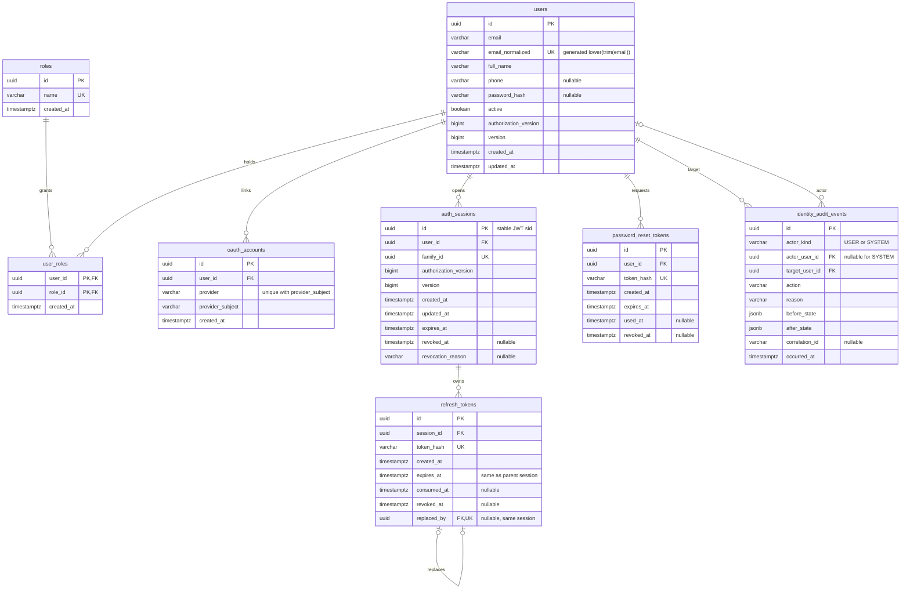

# Identity database foundation

Implemented by `V2__create_identity_tables.sql` in the shared **`swiftdrop`** schema. V1 is unchanged. All eight tables have JPA mappings under `com.swiftdrop.entity.identity`; Hibernate checks those mappings with `ddl-auto: validate`. Flyway alone creates/changes the schema; Spring SQL initialization is disabled.

This migration supplies persistence infrastructure. [IAM-01 registration](registration.md) now uses it to create CUSTOMER accounts; login, credential issuance, Google integration and password-reset delivery remain future work. Only four role definitions are seeded; there are no default accounts/passwords.

## Entity relationships



## What each table does

| Table | Meaning and enforced rules |
| --- | --- |
| `users` | One account across all roles. The database generates `email_normalized = lower(btrim(email))` and enforces its uniqueness, including writes outside Java and concurrent inserts. A nullable password hash permits Google-only accounts. `active` supports suspension; `authorization_version` invalidates older authorization state; `version` is a separate JPA optimistic-lock counter. |
| `roles` | The four allowed role names: CUSTOMER, MERCHANT, COURIER, DISPATCHER_ADMIN. Both UUID IDs and role names are unique. Seed IDs are stable reference data, not user IDs. |
| `user_roles` | Connects an existing user to an existing role. Its composite UUID key prevents duplicate assignments. Public signup's CUSTOMER-only rule is enforced by `RegistrationService`; this table alone does not enforce which caller may assign roles. |
| `oauth_accounts` | Links a user to a lowercase provider name and case-sensitive provider subject. `(provider, provider_subject)` is globally unique; `(user_id, provider)` allows one linked identity per provider for each user. No Google access/refresh tokens are stored. |
| `auth_sessions` | A stable sign-in session and one refresh-token family. `id` will be JWT `sid`; `family_id` is unique. Holds absolute expiry, captured authorization version and revocation with a reason. Multiple sessions per user support multiple devices. |
| `refresh_tokens` | One row per token generation, retaining consumed hashes to detect reuse. Stores only a SHA-256 digest, timestamps and replacement pointer. At most one unconsumed/unrevoked token per session. A composite FK keeps replacement links inside the same session and every token's expiry equal to the parent's absolute expiry. |
| `password_reset_tokens` | Hashed recovery tokens with expiry, usage and revocation. At most one unused/unrevoked request per user; issuing another request must first revoke the previous outstanding one, even if it has expired. |
| `identity_audit_events` | New mechanism because no audit implementation existed. Records actor, target, action, reason, safe before/after JSON objects, correlation ID and time. USER requires an actor FK; SYSTEM requires a null actor. Database triggers reject row updates/deletes; JPA marks the entity immutable. |

All standalone IDs are UUIDs with `gen_random_uuid()` SQL defaults; Hibernate uses UUID generation too. `user_roles` uses the two UUID FKs as its identity. All dates are `timestamptz`, mapped as Java `Instant`; PostgreSQL stores instants independently of the session display timezone. Creation times default in the database. Triggers maintain `users.updated_at` and `auth_sessions.updated_at` for SQL and ORM writers.

Normalized email is case folding plus trimming ordinary surrounding spaces only. It does not remove Gmail dots, strip `+tags`, prove email ownership or implement full email syntax validation. Services must use the same normalization for lookup and add DTO validation. Never accept a client-provided normalized value.

`token_hash` columns accept exactly 64 lowercase hexadecimal characters. Future services must generate high-entropy random opaque tokens and store SHA-256 digests of them; a format constraint cannot prove an input was hashed. Passwords require an adaptive password encoder, not this fast token-hashing method. No plaintext token/password columns exist. Audit JSON must use a safe-field allowlist; its object constraint cannot detect leaked secrets automatically.

FKs preserve referenced identities and history; there are no cascading user deletions. Indexes cover normalized email, role membership in either direction, provider lookup, sessions by user/family/expiry, token hash/current-token/expiry lookups, reset user/expiry lookup, and audit actor/target timelines. Audit triggers are integrity protection, not a security boundary against the database owner; retention and production least-privilege grants remain deployment decisions.

## Transactions future services must use

Database structure supports these operations but does not execute them automatically:

1. **Refresh:** lock/check the session, active account, authorization version and absolute expiry. Conditionally consume the old token only if unused, unrevoked and unexpired. Insert its replacement with the same session/expiry and link `replaced_by`, all in one transaction. The deferred replacement FK allows a forward reference inside that transaction. Concurrent conditional updates have one winner.
2. **Reuse detection:** find the old token by its retained hash. If already consumed, revoke its parent session/family. Do not delete consumed records while the family could still be used.
3. **Revocation:** `auth_sessions.revoked_at` invalidates that entire family. Child tokens do not need mass updates; every credential check must join/check its parent. Suspension/role changes/password reset also increment the user's authorization version and revoke all relevant sessions transactionally. A stored version does not itself enforce authorization.
4. **Reset:** conditionally set `used_at` only for an unused, unrevoked, unexpired token while changing the password, invalidating other tokens/sessions and recording required audit information in the same transaction.
5. **Expired-token cleanup:** retain replay evidence until family expiry. Delete a completed family's token chain in a transaction before its session; deferred self-references permit deleting the chain together. Audit retention requires a separately reviewed procedure.

JPA entities supply validated mappings. IAM-01 adds registration creation methods, user/role repositories and one transactional service, with DTO-only API responses. Add future session/profile mutation methods and locking queries alongside their behavior tests. Entities must never be serialized as public responses.

## Neon connections and environment loading

Runtime queries use `spring.datasource` (Hikari). Flyway uses a **separate direct connection to the same endpoint/database**, built through `DatabaseMigrationConfig` and Spring Boot's `FlywayConnectionDetails` extension. This supersedes the earlier foundation rule requiring the exact same DataSource instance.

Private `backend/.env` keeps the existing names:

```properties
SPRING_DATASOURCE_URL=jdbc:postgresql://YOUR_ENDPOINT-pooler.YOUR_REGION.aws.neon.tech:5432/YOUR_DATABASE?sslmode=require&channelBinding=require
SPRING_DATASOURCE_USERNAME=YOUR_NEON_ROLE
SPRING_DATASOURCE_PASSWORD=YOUR_NEON_PASSWORD
```

Use the actual Java/JDBC URL supplied by Neon Connect, never infer an endpoint from a branch label. Runtime may use either pooled or direct Neon. When no migration override is supplied, the backend removes `-pooler` only from the Neon endpoint hostname and retains database, port and TLS query parameters. Direct runtime URLs and local Compose URLs are left unchanged. Neon documents this pooled/direct hostname convention and recommends direct connections for migrations in its [connection-pooling guidance](https://neon.com/docs/connect/connection-pooling).

Optional overrides, in the same private backend file:

```properties
SPRING_FLYWAY_URL=jdbc:postgresql://YOUR_ENDPOINT.YOUR_REGION.aws.neon.tech:5432/YOUR_DATABASE?sslmode=require&channelBinding=require
SPRING_FLYWAY_USER=YOUR_MIGRATION_ROLE
SPRING_FLYWAY_PASSWORD=YOUR_MIGRATION_PASSWORD
```

Omit the user/password overrides to reuse the runtime credentials. If using a separate migration role, provide its matching password and configure runtime grants before use. Flyway startup needs schema/migration privileges. No real credentials are changed or seeded by this task.

Before opening Flyway's connection, the guard rejects a pooled migration URL, a different normalized endpoint hostname, database or port. For Neon, select the **same compute's** pooled/direct pair; different computes are conservatively rejected even if someone believes they share a branch. Without the Neon control-plane API, the guard establishes the matching endpoint pair, not a lookup of remote branch metadata. URL-embedded credentials and routing overrides such as `options`, `service`, `host` and `database` are rejected; use separate credential variables. Errors do not echo URLs or credentials.

Exact command, from the repository root in PowerShell:

```powershell
.\backend\mvnw.cmd -f backend/pom.xml spring-boot:run
```

The Maven plugin sets the application's working directory to `backend/`. `application.yaml` imports `../.env[.properties]`, then `./.env[.properties]` before creating connections. Explicit placeholders map the shared uppercase keys into both datasource and Flyway properties. Backend values override matching root file values; OS variables/command-line properties have higher precedence. Files use Java-properties syntax (`KEY=value`, no shell `export`, no surrounding quotes; escape a literal backslash as `\\`). Maven does not automatically source `.env` as a shell script.

Root `.env` configures local RabbitMQ and application ports; `backend/.env` contains private Neon credentials; frontend configuration contains no database credentials. Real environment files and keys are Git-ignored and excluded from Docker contexts. Compose connects directly to the selected Neon branch. Automated integration tests use disposable Testcontainers databases. See [README](../../README.md) for infrastructure startup.

Normal startup applies pending migrations through the current shared version and validates Hibernate before serving health. It **will migrate the selected branch**; check your private target before starting. This task's automated tests use disposable PostgreSQL only, never that branch.

## Migration workflow and verification

The M1 history is V1 and V2. The current shared chain continues through V7 for
booking, merchant, execution, and webhook persistence. Never renumber or edit a
migration already applied to a shared environment. V8 is already reserved, so
coordinate the next available version for later changes. No `clean`, reset, `baselineOnMigrate`, schema auto-update or applied-V1
modification is used here.

Run from the repository root with Java 21 and Docker Desktop's Linux engine available:

```powershell
.\backend\mvnw.cmd -f backend/pom.xml --batch-mode --no-transfer-progress -Pintegration verify
git diff --check
```

`IdentitySchemaIT` checks fresh migration, V1 upgrade with preserved unrelated data, repeat migration without reseeding, constraints, concurrent rotation, revocation queries, reset consumption, audit protection and timezone handling. `FoundationIT` starts the application against isolated PostgreSQL/RabbitMQ, validates the current JPA entity model and checks health/access rules. It overrides **both** connections to avoid private Neon settings. `EnvironmentLoadingTest` launches a configuration-only JVM in a temporary backend directory, using synthetic root/backend `.env` files and the actual application YAML; it proves file precedence and credential binding without any database access. `MigrationConnectionPolicyTest` checks direct endpoint derivation and safe rejection of mismatches/embedded secrets.

See [verification record](../verification.md) for observed results and checks not run. Live Neon reachability/credentials are separate from local configuration and migration test results.

## Reconciled design choices

- The earlier checklist used a role-code primary key. This task explicitly requests UUID identifiers, so `roles.id` is UUID and `roles.name` holds the unique agreed vocabulary; `user_roles` references both UUID keys.
- The v3 `RefreshSession` box is implemented as `auth_sessions` plus `refresh_tokens`, preserving a stable session ID and the complete rotation history.
- The earlier shared-DataSource-instance requirement is replaced by direct Flyway plus application runtime connections to the same database, as explicitly requested in this task.
- Reference PDFs/PNGs are preserved. This document is the current implementation ER for M1; merchant/courier operational tables still belong to M2/M5.
